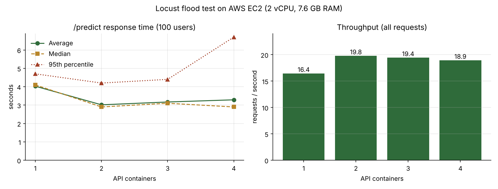

# Bean Leaf Doctor

I'm Sandrine Umugwaneza, and this is my MLOps project at African Leadership University. My focus is using machine learning in agriculture, so I built a tool that tells a farmer whether a bean leaf is healthy or sick, just from a photo taken with a phone.

- **Video demo:** https://youtu.be/MLC9dvZiBN4
- **Web app:** http://16.171.47.170:8501
- **API (Swagger):** http://16.171.47.170:8000/docs

## Why beans

Beans are eaten almost every day in Rwanda, and two diseases, angular leaf spot and bean rust, can cut a harvest badly. Most farmers can't get an agronomist to their field quickly. If a phone photo can flag the disease early, the farmer can remove infected leaves before it spreads.

The model sorts a leaf into one of three classes: **healthy**, **angular leaf spot** or **bean rust**. It also gives short advice, and when it's less than 60% sure, it says so and suggests checking with an agronomist instead of pretending to know.

## The data

I used the [iBean dataset](https://github.com/AI-Lab-Makerere/ibean/) from Makerere University's AI Lab. It has 1,295 photos taken with smartphones in real Ugandan fields, labelled by experts from the National Crops Resources Research Institute. The photos are messy in a good way: soil, grass and fingers are in the frame, like they would be for a real farmer.

| | Angular leaf spot | Bean rust | Healthy |
|---|---|---|---|
| Training | 389 | 393 | 385 |
| Test | 43 | 43 | 42 |

The classes are balanced, so accuracy is a fair way to judge the model.

When I explored the images, three things stood out:

- **Colour:** healthy leaves are the greenest and rust leaves the least green, because of the brown pustules. But the background mixes everything up, so colour alone isn't enough.
- **Brightness:** rust photos are darker on average. I didn't want the model to learn "dark photo = rust", so I randomly change brightness during training.
- **Texture:** I expected sick leaves to have more edges because of the spots, but they don't. The spots are tiny compared with the veins and the background. That's what convinced me to use a CNN rather than simple measurements.

## The model

Everything is in [`notebook/bean_disease_mlops.ipynb`](notebook/bean_disease_mlops.ipynb). I resized the images to 224×224 and used **MobileNetV2** pretrained on ImageNet, because it's small enough to run on a cheap server without a GPU. On top of it I added dropout, L2 regularization and data augmentation, trained with Adam and early stopping, then fine-tuned the last 30 layers with a small learning rate.

On 128 test images the model had never seen:

| Accuracy | Loss | Precision | Recall | F1-score | ROC-AUC |
|---|---|---|---|---|---|
| 91.4% | 0.265 | 91.8% | 91.5% | 91.3% | 97.9% |

It almost never misses angular leaf spot or a healthy leaf (around 98%). Bean rust is harder: it finds 79% of rust leaves, and most of its mistakes call rust "angular leaf spot", because both diseases start as small brown spots.

## Retraining

Anyone can teach the model with new photos from the **Upload & retrain** page:

1. Pick a label and upload several photos at once.
2. Each photo is resized, saved in `data/uploads/`, and recorded in a SQLite database.
3. Once 10 new photos are waiting, the app recommends retraining, and the **Retrain** button starts it.
4. Retraining loads my saved model (`models/bean_disease_model.h5`) and fine-tunes it on the new photos plus 100 old photos per class, so it doesn't forget what it already knew.
5. The new model is tested on the same 128 test images. It only replaces the old one if it isn't worse, and every version is kept in `models/archive/`.

In my test run with 3 new photos, accuracy went from 91.41% to 92.19%. Most of that gain comes from the extra fine-tuning rather than the 3 photos themselves, but it shows the whole loop works.

## Load testing with Locust

I deployed the app on an AWS EC2 server in Stockholm (2 vCPUs, 7.6 GB RAM) with an nginx load balancer in front of the API containers. Then I used [Locust](locust/locustfile.py) from my laptop in Rwanda to simulate 100 users sending real leaf photos to `/predict` for 2 minutes, with 1, 2, 3 and 4 API containers.

| Containers | Requests | Failures | Average | Median | 95th percentile | Requests/s |
|---|---|---|---|---|---|---|
| 1 | 1,775 | 0 | 4.0 s | 4.1 s | 4.7 s | 16.5 |
| 2 | 2,120 | 0 | 3.0 s | 2.9 s | 4.2 s | 19.8 |
| 3 | 2,062 | 0 | 3.2 s | 3.1 s | 4.4 s | 19.4 |
| 4 | 2,027 | 0 | 3.3 s | 2.9 s | 6.7 s | 18.9 |



Going from 1 to 2 containers made predictions about 25% faster and let the server handle 20% more requests. After that, adding containers didn't help, and with 4 the slowest requests got worse. The server only has 2 CPU cores, so extra containers just fight over the same CPU. For this machine, 2 containers is the sweet spot. Not a single request failed in any test.

Each prediction takes around 3 seconds under this load. Part of that is the photo travelling from Kigali to Stockholm, and part is running the model on a CPU with 99 other people waiting in line.

The raw CSV files are in [`locust/results/`](locust/results/), and `python locust/summarize.py` rebuilds the table.

## Running it yourself

**With Docker (easiest):**

```bash
git clone https://github.com/sand02004/bean_disease_mlops.git
cd bean_disease_mlops
docker compose up --build
```

The first build takes 10–15 minutes. Then open http://localhost:8501 for the app and http://localhost:8000/docs for the API. To run 2 API containers: `docker compose up -d --scale api=2`, then `docker compose restart nginx`.

**Without Docker:** you need Python 3.12 (TensorFlow doesn't support 3.14 yet).

```bash
python -m venv venv
.\venv\Scripts\Activate.ps1        # on Mac/Linux: source venv/bin/activate
pip install -r requirements.txt
uvicorn api.main:app --reload      # terminal 1
streamlit run ui/app.py            # terminal 2
```

**On AWS:** I used an Ubuntu EC2 instance, installed Docker, cloned this repo and ran `docker compose up -d --build`. Remember to open ports 8000 and 8501 in the security group, which caught me out the first time.

**Load test:**

```bash
locust -f locust/locustfile.py --host http://SERVER_IP:8000 --headless -u 100 -r 10 -t 2m --csv locust/results/containers_1
```

## How the code is organised

```
notebook/    the full training and evaluation notebook
src/         preprocessing, model + retraining, prediction, database
api/         FastAPI service (predict, upload, retrain, stats, health)
ui/          Streamlit web app
data/        train and test images
models/      the trained model (.h5)
locust/      load test script and results
```

## What I'd improve

Uploaded photos and retrained models live inside the container, so they disappear if it's rebuilt; in real use I'd store them in S3. I'd also put the app behind a proper domain with HTTPS, and collect more bean rust photos, since that's where the model struggles most.

Thanks to Makerere AI Lab for making the dataset public.